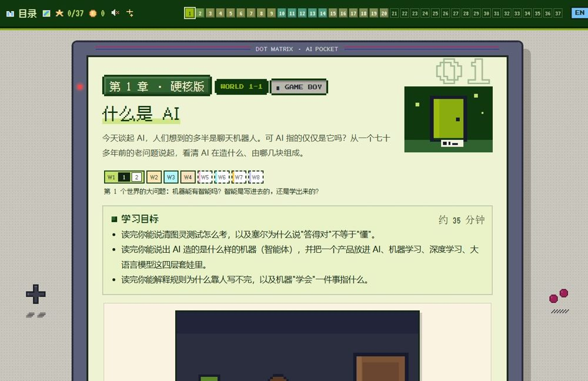
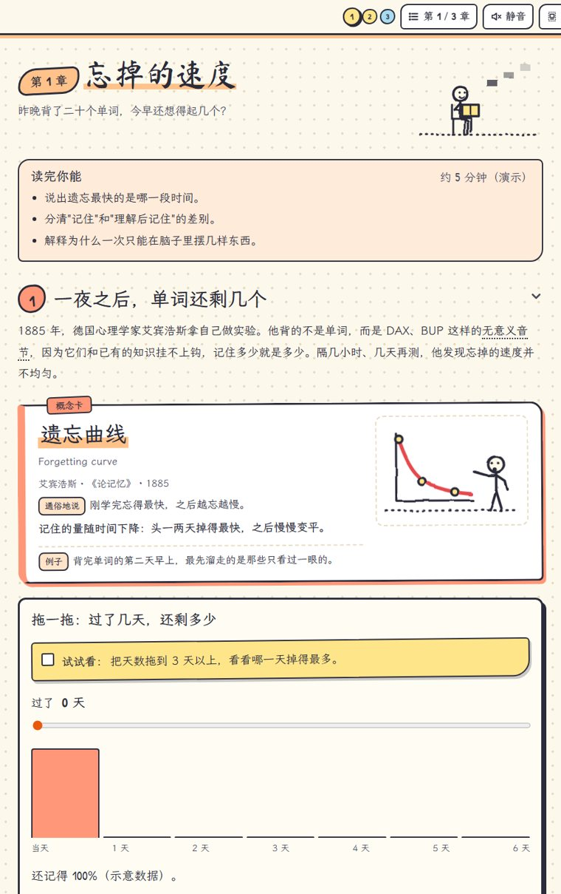
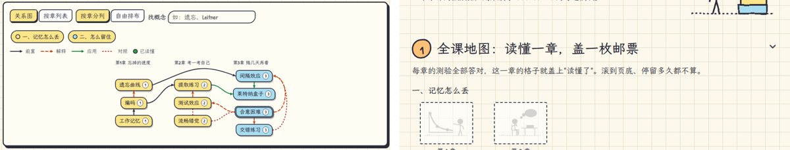
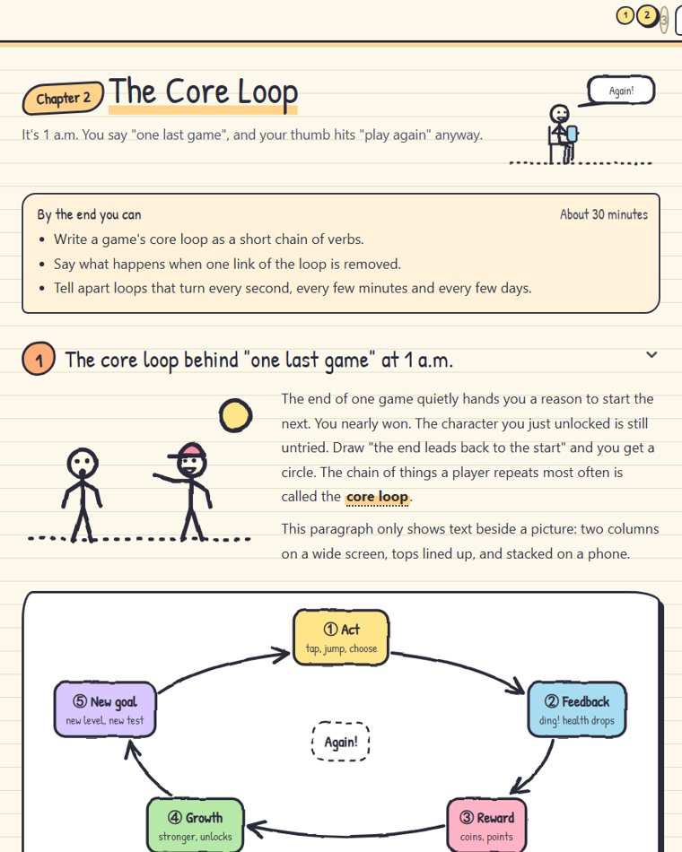
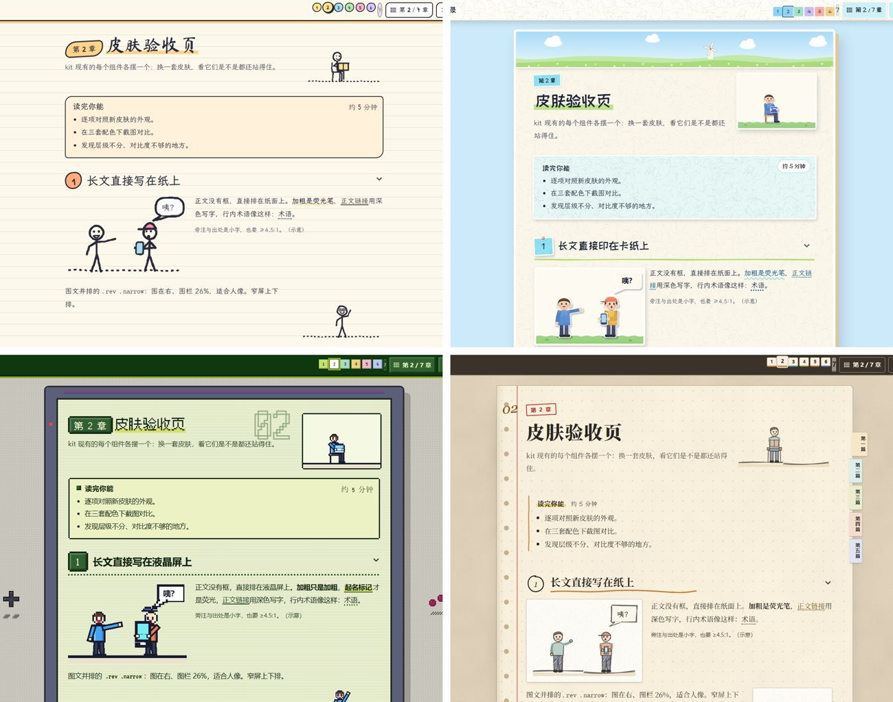

# Interactive Course Kit

**用 Claude Code 做"读起来舒服、看得懂、有趣"的互动学习网页课程。**
A set of Claude Code skills for building interactive, illustrated learning web courses. [English](README.en.md)

**在线演示**：[五套皮肤图库、三个样板章、组件演示页](https://penstic123-code.github.io/Interactive-course-kit/)


## 背景

我用 Claude Code 做了几门完整的网页课程，面向想系统学会一个领域的普通人：

| 课程 | 风格 | 在线地址 |
|---|---|---|
| 游戏设计 | 手绘笔记本 | https://111.231.53.50/game-design-course/ |
| AI 入门 | 各章一种复古媒介（掌机、终端……） | https://111.231.53.50/ai-course-pro/ |
| 数据科学 | 纸片爬塔，勇士一层层打守层者 | https://111.231.53.50/data-science/ |
| 人类学 | 田野手账 | https://111.231.53.50/anthropology-course/ |

做的过程中，每一条关于画面、组件、互动、文风的反馈都被记下来、改成规则。这个仓库就是那些规则和代码的整理版：交给 Claude Code，你和它就能按同一套标准做出新的课程，不用每次从零拼凑，也少一股 AI 味。

| 数据科学 | AI 入门 | 人类学 |
|---|---|---|
|  |  |  |

## 你和 AI 一起做

这套 skill 不能一键做出一门完美的课。不是工具不够多，而是好教材要靠读的人来判断：

- AI 没有身体。它没在凌晨一点对自己说过"最后一局"，也没被一道题卡住过，挑不准哪个例子能让人一下子懂。
- AI 不知道你的读者是谁、卡在哪。它理解东西的方式和人不一样：一段话它读着顺，人可能早就跟丢了。
- 好不好读、有没有意思，只有人读过才知道。

所以 skill 把你放在几个关键位置：选风格、定全课方案、看章纲、读样板章、每篇抽一章。AI 负责铺开内容、配图、写互动、跑检查；你负责说"这里没看懂""这个例子离我的生活太远""这段太长了"。上面几门课都是这样一轮轮改出来的。

## 里面有什么

| Skill | 做什么 |
|---|---|
| `course-kit` / `course-kit-en` | 视觉与组件工具箱（中文版 / 英文版，共用一套代码） |
| `zh-teaching-prose` | 中文讲解文风：古典风格 + 非虚构写作，去掉 AI 腔 |
| `en-teaching-prose` | 英文讲解文风，按英文习惯写，不是逐句翻译 |

## 特点

### 一个主题娓娓道来
动笔前先写章纲：这一章回答一个问题，每节回答上一节逼出来的问题；按概念难度定一章讲几个、每个给多少篇幅，一段只引入一个新东西。从熟悉的处境讲起，先体验，再起名字。难度适中，发明故事、推导、数学和研究细节默认收起，只露一个具体的问题式标题和一句介绍，想深入的人自己展开。


### 每一两段就有一个视觉
按"这一段在干什么"选图：讲结构用概念图解，讲历史用真实图片和时间线，举例用插画轮播。概念卡、原理框里的长文字也要配图。宽屏图文并排、顶端对齐，窄屏上下排。


### 让读者随时知道在讲哪个概念
小标题写出概念名，正文第一次起名处用荧光笔标出，紧接一张带小图的概念卡，三处名字一致。`check.mjs` 会查三处对不对得上。



### 41 个按功能组织的组件
与皮肤无关：概念卡、原理框、例子与反例轮播、对照两栏、真实图片、数据表、先猜后揭晓、试试看、收起支线、练习、要点、你的思考等。下图是皮肤验收页里的一部分。


### 12 种概念图解模板
循环、嵌套圈、流程、象限、对比、时间轴、曲线、树、维恩、天平、网络、光谱、层叠。先量文字宽度再画线，标签不压线；点图里任何一块会高亮并说明它在做什么。


### 互动是"拆房子"，不是选择题
直接拖、调、拼、排，立刻看到后果：漫画分镜、逐步演示、公式拆解、动手分类、分局小游戏、前后对比、翻牌、热区图等。出场前一句话说清它要回答什么问题，"试试看"任务完成时给反馈。


### 皮肤先验收，再上课
开课先问你选哪套（见下方"皮肤"），AI 不在课程页里临时拼样式。想要别的风格，可以和 AI 一起设计一套新皮肤：先聊想要的感觉和参考，做出展示页和一章样稿，你验收过就进库，之后的课都能用。读者可在顶栏切换亮色 / 护眼配色和动效档位（全开、轻量、关），并尊重系统的"减少动态"设置。

### 可选模块
概念关系图（和概念卡共用一份数据）、术语表、闪卡、集邮式阅读激励（读懂一章盖一枚邮票）、点击才说话的陪伴角色、声音（默认静音）。



### 一键检查
写代码时看不到真实的字宽和屏宽，所以写完必须跑检查：

```text
node tools/check.mjs <课程文件夹绝对路径>
1 语法        每个 .js 和内联脚本试编译
2 接线        JS 找的类名页面里有没有、样式有没有
2b 概念凸显   概念卡、荧光笔、小标题三处名字一致
3 配图密度    两个视觉之间超过约 300 字就报
4 链接        本地图片、脚本路径是否存在
5 运行        无头浏览器在 420 / 1100 宽度点遍按钮、拖遍滑块，报错误、溢出、图内文字压线
6 截图        每页两种宽度各一张，交给人或 agent 看
```

### 中英双语
skill 本身有中英两份，代码共用；`new-course.mjs --lang en` 直接生成英文课，界面文字、图解标点都自动切换。



## 皮肤

开新课时，AI 先问你要哪套美术风格，再问读者、章数、语言和模块，然后交一份知识地图和章节表给你确认，确认后才开始做。目前有五套验收过的皮肤，组件和互动在五套里都能用，换皮肤不用改正文：

| 皮肤 | 样子 | 适合 |
|---|---|---|
| `notebook` 手绘笔记本 | 横线纸、墨线火柴人、色块 | 设计、思维、文科 |
| `paper` 纸片 | 卡纸剪纸、白裁边、柔和投影，目录页是一座塔 | 有故事、有角色的课 |
| `pixel` 掌机像素 | 四阶绿液晶屏、像素插画、阶梯动效 | 计算、编程、游戏化的课 |
| `fieldbook` 田野手账 | 方格活页纸、彩铅、胶带贴的照片和票根 | 人文、社科、历史 |
| `collage` 贴纸拼贴 | 手工纸、马蒂斯剪纸色，照片、名画和剪纸人都做成白边贴纸 | 名画、历史照片多的入门课 |



每套皮肤的验收页在 `skins/<名>/gallery.html`，把所有组件摆在一页上，双击就能看。想要新风格，按 `references/skin-contract.md` 先做一章样稿再入库。

## 怎么用

### 1. 安装

把 `skills/` 下的四个文件夹复制到 Claude Code 的 skills 目录：

```bash
# macOS / Linux
cp -r skills/* ~/.claude/skills/
# Windows (PowerShell)
Copy-Item -Recurse skills\* $HOME\.claude\skills\
```

### 2. 开一门课

在 Claude Code 里说"帮我做一门关于××的互动课程"，之后是这样走的：

| 步骤 | AI 做什么 | 你做什么 |
|---|---|---|
| 选风格 | 推荐五套皮肤，说明各适合什么课 | 选一套 |
| 定方案 | 问读者、长度、语言、模块，给出知识地图和章节表 | 确认，或改章节 |
| 写章纲 | 每章一页：这章回答什么问题、每节怎么接上一节、概念难度、例子和互动各为了什么；再派一个没有上下文的 agent 查逻辑 | 样板章和每篇第一章细看，其余扫一眼 |
| 做样板章 | 照章纲写第一章，跑检查、截图 | 从头读一遍，说出哪里没看懂、哪里读着不舒服 |
| 铺开 | 一章章写，每章过脚本检查和无上下文读者审读 | 每篇抽读一章 |
| 收尾 | 全课体检、可选模块、英文版 | 最后验收 |

反馈越具体越好用："第 3 节突然冒出'损失'，前面没讲过"比"不太好懂"有用得多。

### 3. 手动命令

也可以手动生成骨架和跑检查：

```bash
node ~/.claude/skills/course-kit/starter/new-course.mjs <课程文件夹绝对路径> <皮肤名>
node ~/.claude/skills/course-kit/tools/check.mjs <课程文件夹绝对路径> --fast
```

内容规范（八条教学原则、章纲与难度分、验收标准、制作流程）在 `course-kit/references/content-rules.md`，可以整份复制到你的项目里当 `CLAUDE.md`。

## 要求与限制

- 课程是纯前端、离线可用的 HTML，双击就能打开，不需要构建。
- 检查工具需要 Node 22+ 和 Edge 或 Chrome（无头模式），会自动查找，也可用环境变量 `EDGE_PATH` 指定。目前只在 Windows 上实测过。
- 暗色配色有变量但未完整验收。

## 许可

代码与文档：MIT。随附的第三方资源各有许可：Patrick Hand 和 Fusion Pixel 字体为 SIL Open Font License（见各皮肤 `fonts/` 下的许可文件），Rough.js 为 MIT。
